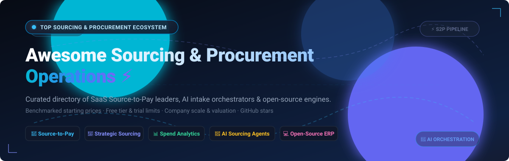

<div align="center">



# Awesome Sourcing & Procurement Operations 🚀

**Curated Hub for Source-to-Pay (S2P) Automation, Strategic Sourcing, Intake Orchestration & Sovereign Procurement Engines**

[](https://github.com/ishandutta2007/Awesome-Awesome-Awesome)<a href="https://discord.gg/jc4xtF58Ve"></a>
[](https://github.com/ishandutta2007/Awesome-Sourcing-Procurement-Operations/stargazers)
[](https://github.com/ishandutta2007/Awesome-Sourcing-Procurement-Operations/network/members)
[](https://github.com/ishandutta2007/Awesome-Sourcing-Procurement-Operations/blob/main/LICENSE)
[](https://github.com/ishandutta2007/Awesome-Sourcing-Procurement-Operations/pulls)
<a href="https://github.com/ishandutta2007"></a>

*An authoritative, SEO-indexed directory tracking commercial enterprise SaaS platforms, AI-native intake orchestrators, and open-source e-procurement architectures.*

</div>

---

## 📑 Table of Contents

- [🌐 Sector Overview & Market Dynamics](#-sector-overview--market-dynamics)
- [🏢 SaaS & Enterprise S2P Platforms](#-saas--enterprise-s2p-platforms)
- [💻 Open-Source Procurement & Sourcing Projects](#-open-source-procurement--sourcing-projects)
- [🏗️ Recommended Stacks & Architectural Blueprints](#️-recommended-stacks--architectural-blueprints)
- [🤝 How to Contribute](#-how-to-contribute)
- [⭐ Star History](#-star-history)
- [💖 Support & Community](#-support--community)
- [⚖️ Disclaimer](#️-disclaimer)

---

## 🌐 Sector Overview & Market Dynamics

The global **procurement software and sourcing operations market** is valued at approximately **$8.9 billion to $10.4 billion (2025–2026)** and is projected to expand past **$16.0 billion by 2030** at a Compound Annual Growth Rate (CAGR) of **9.8% to 10.4%**, powered by the rise of agentic AI, real-time spend analytics, and automated compliance enforcement.

From a structural perspective, the market is **moderately fragmented**: while legacy multi-billion-dollar enterprise suites (SAP Ariba, ServiceNow, Workday, Coupa) anchor core ERP-adjacent source-to-pay pipelines, significant fragmentation persists across specialized sub-domains—such as front-door intake orchestration (Zip), autonomous tail-spend bidding (Fairmarkit), and multi-variable combinatorial sourcing optimization (Keelvar)—preventing a single winner-take-all monopoly and driving active demand for open APIs and modular architectures.

---

## 🏢 SaaS & Enterprise S2P Platforms

The table below catalogs top enterprise platforms ranked by **Company Scale (Market Capitalization / Valuation / Revenue)** in descending order, providing benchmarked starting-tier pricing and concrete free-tier/trial terms.

| Platform / Vendor 🏢 | Company Scale (Revenue / Valuation) 📈 | Starting Tier Pricing 💵 | Free Tier / Trial Limit 🎁 | Core Sourcing & Procurement Capabilities ⚙️ |
| :--- | :--- | :--- | :--- | :--- |
| **[SAP Ariba](https://www.sap.com/)** | **~$240B Market Cap** (SAP SE) <br> • $35.5B+ Annual Revenue <br> • $3.0B+ S2P Annual Run Rate | Starts at **$2,420 / month** (~$29,040 / yr) for baseline Strategic Procurement user blocks; full-suite enterprise S2P contracts typically scale from **$80,000 to $300,000+ / yr** | **Free forever** SAP Business Network Standard Account for suppliers (free to transact up to 4 purchase orders/invoices or $50,000 spend annually); buyers receive a **30-day guided enterprise sandbox / PoC** upon qualified sales review | Comprehensive end-to-end Source-to-Pay (S2P), global multi-million supplier network, category management with PESTLE analysis, Joule AI copilot, contract lifecycle management, and multi-ERP integration. |
| **[ServiceNow SPO](https://www.servicenow.com/)** | **~$195B Market Cap** <br> • $10.9B Annual Revenue | Fulfiller licenses start at **$100 to $125 / user / month** (minimum enterprise deployment contracts start at **$30,000 to $50,000 / yr**); casual requesters access via ShoppingHub | **Free forever** Personal Developer Instance (PDI) with full Now Platform developer sandbox (renewable in 10-day active increments); enterprises get a **30-day proof-of-concept instance** with guided SLA workflows | Sourcing and Procurement Operations (SPO) on the Now Platform, ShoppingHub guided buying, virtual agent deflection, cross-functional procurement playbooks, supplier risk assessment, and ERP orchestration. |
| **[Workday Strategic Sourcing](https://www.workday.com/)** *(formerly Scout RFP)* | **~$70B Market Cap** <br> • $8.2B Annual Revenue | Standalone sourcing packages start at **$20,000 to $35,000 / yr** (~$1,500–$2,500 / buyer seat / yr); enterprise multi-module contracts scale up to **$100,000+ / yr** | **Free forever** supplier response portal (unlimited RFI/RFP bid submissions and reverse auction participation for invited vendors); enterprise buyers receive a **14 to 30-day guided sandbox trial** | Collaborative sourcing pipelines, electronic RFx event management, automated line-item bid evaluations, reverse e-auctions, contract milestone tracking, and native Workday Financials integration. |
| **[Coupa](https://www.coupa.com/)** | **$8.0B Valuation** (Acquired by Thoma Bravo) <br> • ~$850M Annual Revenue | Core mid-market procurement starts at **$21,000 to $60,000 / yr**; median annual contract value tracks at **$93,000 to $95,000 / yr**; large enterprise suites scale past **$150,000+ / yr** | **Free forever** Coupa Supplier Portal (CSP) for all suppliers (free PO receipt, digital catalog management, e-invoicing, and early payment tracking); buyers receive a **30-day sales-guided PoC pilot** | Agentic AI spend management platform with Coupa Navi Agent Studio, BOM-driven direct materials sourcing, Coupa Orchestrator drag-and-drop workflows, and global community spend intelligence. |
| **[GEP SMART](https://www.gep.com/)** | **~$2.0B Est. Valuation** (Private) <br> • ~$450M Annual Revenue | Single-module packages (e.g. Sourcing or Spend Analytics) start at **$75,000 / yr**; comprehensive enterprise S2P rollouts scale from **$350,000 to $1,500,000+ / yr** | **Free forever** access to the GEP Supplier Network for registered vendors to submit quotes and bids; enterprise buyers receive a **30-day tailored pilot / demo sandbox** evaluating historical category spend | AI-native source-to-pay software, automated RFx/e-auctions with auto-scoring, contract lifecycle management with AI risk assessment, supplier performance dashboards, and autonomous procurement. |
| **[Zip](https://zip.com/)** | **$1.5B Valuation** (Series C/D Unicorn) <br> • ~$60M Annual Recurring Revenue | Mid-market core intake-to-procure starts at **$40,000 to $80,000 / yr** (unlimited requester seats); enterprise tier with two-way ERP sync and PO management starts at **$80,000 to $120,000+ / yr** | **14-day guided proof-of-concept / sandbox trial** with custom intake forms, approval routing, and bi-directional ERP integration testing (no permanent free buyer tier) | "Single front door" procurement intake orchestration, AI workflow routing from natural language, AI Price Negotiation Agent (targeting 3–5% contract savings), and Invoice-to-Contract compliance. |
| **[Jaggaer](https://www.jaggaer.com/)** | **~$1.5B Valuation** (Vista Equity / Cinven) <br> • ~$280M Annual Revenue | Modular sourcing packages start at **$30,000 to $50,000 / yr**; comprehensive Source-to-Pay (JAGGAER One) deployments range from **$120,000 to $300,000+ / yr** | **Free forever** access to Jaggaer Supplier Network for vendors to submit bids and manage digital catalog items; enterprise purchasing teams receive a **30-day structured sandbox trial** | Direct and indirect spend management, bulk RFx template imports (25.3 release), automated supplier gating to block unqualified vendors, intake orchestration, and university/manufacturing focus. |
| **[Ivalua](https://www.ivalua.com/)** | **$1.1B Valuation** (Unicorn) <br> • ~$200M Annual Revenue | Foundation Source-to-Contract tier starts at **$150,000 / yr**; complete enterprise S2P implementations scale from **$400,000 to $1,000,000+ / yr** based on modular scope | **Free forever** supplier collaboration portal for questionnaire completion, bid uploads, and e-invoicing; procurement teams receive a **30-day proof-of-concept environment** for qualified evaluations | Single-codebase Source-to-Pay platform, AI-powered Intake Management, IVA conversational procurement copilot, ESG-weighted supplier questionnaire analysis, and risk analytics. |
| **[Fairmarkit](https://www.fairmarkit.com/)** | **~$200M Valuation** ($78M Total Funding) <br> • ~$25M Annual Revenue | Tail-spend automation packages start at **$35,000 to $50,000 / yr**; scales up to **$150,000+ / yr** based on annual non-catalog transaction volume and ERP connectors | **Free forever** supplier participation portal (invited suppliers bid and submit quotes with zero transaction fees); enterprise buyers receive a **30-day Proof of Value (PoV) pilot** on historical spend | Autonomous tail-spend sourcing, AI supplier recommendation engine, automated quote comparison side-by-side, ERP integration plug-ins (SAP, Coupa, Oracle), and savings attribution. |
| **[Keelvar](https://www.keelvar.com/)** | **~$150M Valuation** ($43M Total Funding) <br> • ~$20M Annual Revenue | Entry-level tier starts at **$25,000 / yr**; core Sourcing Optimizer module starts at **$60,000 / yr**; enterprise autonomous sourcing bots (Kai) scale to **$250,000–$300,000+ / yr** | **Free forever** bidding interface for invited suppliers (zero cost for vendors); buyers receive a **14 to 30-day guided pilot / PoC** evaluating complex sourcing events | Advanced sourcing optimization for multi-variable bids (freight, packaging, direct materials), scenario "what-if" simulations, and autonomous procurement bots. |

---

## 💻 Open-Source Procurement & Sourcing Projects

Open-source and self-hosted procurement engines are crucial for organizations seeking data sovereignty, customized approval workflows, and freedom from per-transaction licensing models. 

The list below is strictly ranked by **GitHub Star Count** in descending order, with each social star badge linking directly to the repository's stargazers page.

1. **[ERPNext (Frappe)](https://github.com/frappe/erpnext)** [](https://github.com/frappe/erpnext/stargazers)  
   *Free and open-source enterprise resource planning system with comprehensive Buying and Sourcing modules.* Supports Material Requests, Supplier RFQs, Supplier Quotation comparison matrices, Purchase Orders, Automated Reorder Levels, 3-Way Invoice Matching, and an independent Supplier Portal. GPL-3.0 licensed.

2. **[ArcKit](https://github.com/tractorjuice/arc-kit)** [](https://github.com/tractorjuice/arc-kit/stargazers)  
   *Enterprise Architecture Governance Harness utilizing AI coding assistants for procurement assurance.* Enables organizations to conduct automated architectural evaluations, vendor RFP technical compliance checks, and delivery assurance against corporate IT standards. MIT licensed.

3. **[BidMaster-Pro](https://github.com/guangshu100/BidMaster-Pro)** [](https://github.com/guangshu100/BidMaster-Pro/stargazers)  
   *Full-lifecycle intelligent bidding and tendering AI agent.* Automates tender document parsing, tender interpretation, proposal generation, 21 automated compliance checks, OCR extraction, and multi-model RAG knowledge base integration for RFP responses. Apache-2.0 licensed.

4. **[phase4](https://github.com/phax/phase4)** [](https://github.com/phax/phase4/stargazers)  
   *Production-grade AS4 client and server integration engine with native Peppol & CEF eDelivery support.* Essential open-source backbone for cross-border European e-procurement, electronic order exchanges, and compliant e-invoicing pipelines. Apache-2.0 licensed.

5. **[ph-ubl](https://github.com/phax/ph-ubl)** [](https://github.com/phax/ph-ubl/stargazers)  
   *High-performance Java library for reading, validating, and writing Universal Business Language (UBL 2.0–2.5) documents.* Powers machine-readable purchasing, electronic tenders, purchase orders, despatches, and invoice exchanges globally. Apache-2.0 licensed.

6. **[OpenProcurement (Prozorro)](https://github.com/openprocurement/openprocurement.api)** [](https://github.com/openprocurement/openprocurement.api/stargazers)  
   *Core API and database interface powering Ukraine's national Prozorro e-procurement infrastructure.* Implements the Open Contracting Data Standard (OCDS), competitive reverse e-auctions, transparent public tenders, and multi-platform commercial broker integrations. Apache-2.0 licensed.

7. **[eForms-SDK](https://github.com/OP-TED/eForms-SDK)** [](https://github.com/OP-TED/eForms-SDK/stargazers)  
   *European Commission Publications Office SDK providing schemas, validation rules, and templates for EU public procurement notices.* Standardizes digital tender advertisements, contract award notices, and public buyer workflows across the European Union. EUPL-1.2 licensed.

8. **[ePO (eProcurement Ontology)](https://github.com/OP-TED/ePO)** [](https://github.com/OP-TED/ePO/stargazers)  
   *Formal semantic OWL ontology and linked-data foundation for public procurement.* Provides machine-readable definitions and relationships across the entire source-to-pay lifecycle, connecting tender requirements, buyers, bidders, and contracts. CC0-1.0 licensed.

9. **[buyer-eval-skill](https://github.com/salespeak-ai/buyer-eval-skill)** [](https://github.com/salespeak-ai/buyer-eval-skill/stargazers)  
   *Autonomous B2B software vendor evaluation skill for Claude Code.* Automates technical RFP questionnaires, orchestrates conversational interviews between AI buyer and vendor agents, and produces auditable, evidence-based scoring matrices. MIT licensed.

10. **[procurement-ai-assistant](https://github.com/AmirLayegh/procurement-ai-assistant)** [](https://github.com/AmirLayegh/procurement-ai-assistant/stargazers)  
    *AI-powered procurement copilot utilizing vector embeddings and semantic search (Google Cloud Sweden Hackathon Winner).* Enables retail buyers to match unstructured natural-language purchase requisitions against catalog inventory and past sourcing agreements. MIT licensed.

11. **[federal-contracting-mcps](https://github.com/1102tools-dev/federal-contracting-mcps)** [](https://github.com/1102tools-dev/federal-contracting-mcps/stargazers)  
    *Collection of free Model Context Protocol (MCP) servers connecting LLMs to US federal procurement systems.* Provides direct agent access to SAM.gov opportunities, USAspending data, GSA CALC+ labor rate benchmarks, and Federal Acquisition Regulation (FAR) clauses. MIT licensed.

12. **[e-procure](https://github.com/Gichure/e-procure)** [](https://github.com/Gichure/e-procure/stargazers)  
    *Spring Boot microservices-based enterprise e-procurement suite.* Features dedicated modules for purchase requisitions, approval chains, purchase order issuance, vendor management, bid management, and invoice processing orchestrated via Camunda BPMN workflows and Apache Kafka. MIT licensed.

13. **[procurement-management](https://github.com/samirsaci/procurement-management)** [](https://github.com/samirsaci/procurement-management/stargazers)  
    *Python procurement process optimization and spend data science library.* Contains analytical models for spend cube construction, Economic Order Quantity (EOQ) simulations, supplier lead-time variance analysis, and purchase order cycle time reduction. MIT licensed.

14. **[mcp-procurement](https://github.com/zavora-ai/mcp-procurement)** [](https://github.com/zavora-ai/mcp-procurement/stargazers)  
    *AI-powered procurement engine providing 37 MCP tools across the entire source-to-pay lifecycle.* Equips autonomous AI agents with capabilities for supplier onboarding, RFQ generation, purchase order approval gates, contract tracking, 3-way matching, carbon footprint scoring, price benchmarking, and maverick spend detection. MIT licensed.

15. **[VendSync (BidFlow)](https://github.com/RavalMunjal/VendSync)** [](https://github.com/RavalMunjal/VendSync/stargazers)  
    *Full-stack Procurement & Vendor Management ERP built on React, Node.js, and MongoDB.* Covers end-to-end purchasing from RFQ creation to invoice generation, featuring role-based access control, a dedicated vendor self-service portal, side-by-side quotation comparison with lowest-price highlighting, and PDF generation. MIT licensed.

16. **[OpenTradeIntel](https://github.com/b2baitrade-ui/opentradeintel)** [](https://github.com/b2baitrade-ui/opentradeintel/stargazers)  
    *B2B sourcing intelligence and public procurement notice discovery engine.* Ingests public tenders from the European TED Search API, normalizes notice schemas, and calculates deterministic matching scores (0–100) against internal supplier product catalogs; includes CLI and MCP interfaces. MIT licensed.

17. **[aribaiq](https://github.com/jvasanthada/aribaiq)** [](https://github.com/jvasanthada/aribaiq/stargazers)  
    *Python procurement analytics and supplier intelligence package.* Computes on-time delivery rates, defect rates, spend concentration ratios, and ESG-weighted vendor scores, outputting GenAI prompt templates for LLM-driven negotiation prep. MIT licensed.

---

## 🏗️ Recommended Stacks & Architectural Blueprints

When designing a modern, sovereign, or composable procurement technology stack, organizations frequently combine specialized tools across architectural layers:

```
┌────────────────────────────────────────────────────────────────────────┐
│                   1. INTAKE & ORCHESTRATION LAYER                     │
│    • Zip (SaaS)  • ServiceNow SPO (SaaS)  • mcp-procurement (OSS MCP)  │
└───────────────────────────────────┬────────────────────────────────────┘
                                    │
┌───────────────────────────────────▼────────────────────────────────────┐
│                  2. STRATEGIC SOURCING & RFQ ENGINE                    │
│ • Keelvar (Optimization) • Workday Strategic Sourcing • BidMaster-Pro  │
│ • Fairmarkit (Tail Spend) • VendSync (Quotation Matrix)                │
└───────────────────────────────────┬────────────────────────────────────┘
                                    │
┌───────────────────────────────────▼────────────────────────────────────┐
│                3. B2B PROTOCOL & DOCUMENT INTERCHANGE                  │
│ • phase4 (AS4 / Peppol) • ph-ubl (UBL 2.5) • OpenProcurement (OCDS)   │
└───────────────────────────────────┬────────────────────────────────────┘
                                    │
┌───────────────────────────────────▼────────────────────────────────────┐
│                 4. ERP, REQUISITIONS & 3-WAY MATCHING                  │
│   • SAP Ariba / Coupa / Jaggaer (Enterprise)  • ERPNext (Open-Source)  │
│   • e-procure (Microservices + Camunda BPMN)                           │
└───────────────────────────────────┬────────────────────────────────────┘
                                    │
┌───────────────────────────────────▼────────────────────────────────────┐
│              5. SPEND INTELLIGENCE & SUPPLIER ANALYTICS                │
│ • aribaiq (Python) • OpenTradeIntel (Tender Matching) • procurement-mg │
└────────────────────────────────────────────────────────────────────────┘
```

---

## 🤝 How to Contribute

Contributions from procurement leaders, developers, and researchers are warmly welcomed! 🌟

1. **Fork the repository** to your GitHub account.
2. **Create a descriptive feature branch**: `git checkout -b feature/add-procurement-tool`.
3. **Add or update an entry** in `README.md` following the established table or open-source list format:
   - For SaaS: include specific starting tier pricing, explicit free tier / trial terms, company scale, and key capabilities.
   - For Open-Source: include owner/repo link, Shields.io social star badge linking to `/stargazers`, concise description, and license.
4. **Ensure links are valid and active**.
5. **Submit a Pull Request** with a clear explanation of why the tool belongs in this curated ecosystem.

---

## ⭐ Star History

[](https://star-history.dera.page/#ishandutta2007/Awesome-Sourcing-Procurement-Operations&type=date&legend=top-left)

---

## 💖 Support & Community

If this curated repository helped you benchmark enterprise procurement tools, architect a source-to-pay workflow, or discover open-source sourcing engines, please consider supporting the project:

- ⭐ **Star this repository** to help others discover it on GitHub.
- 🍴 **Fork and share** it with your engineering and procurement peers.
- ☕ **Sponsor the maintainer** or buy a coffee via the [GitHub Sponsors Dashboard](https://github.com/sponsors/ishandutta2007).

Thank you for contributing to an open, intelligent, and transparent sourcing & procurement operations ecosystem! 🙌

---

## ⚖️ Disclaimer

- This repository is a community-curated, independent directory and does not constitute a formal commercial endorsement or financial advice.
- Starting tier prices and free trial policies are based on publicly verified vendor documentation and SaaS benchmark registries (e.g., Vendr, Capiche, Capterra, Gartner Peer Insights) as of late 2026; actual enterprise quotes vary based on contract volume, integrations, and negotiations.
- Ensure all procurement implementations handle sensitive supplier, payment, and pricing data in compliance with relevant data protection laws (GDPR, CCPA), anti-bribery regulations, and public procurement transparency standards (e.g., GPA, EU Directives).
